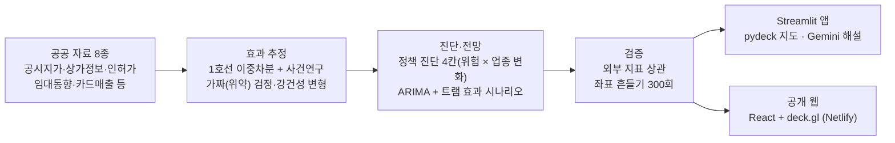

# 트램은 매출이 아니라 거리를 바꾼다
**대전 1호선 이중차분으로 미리 읽는 트램 2호선 상권 변화 사전 경고 지도**

> v1.0 임시 확정판(2026-11-13). 공개 정리: 결과 파일 5개에서 8989에서 온 행정동·상권별 값 열(`sales_per_store`, `sales_chg2y_trdar`, `resident`)을 지우고 작업 도구 캐시를 뺐습니다. 분석 결과·화면은 그대로입니다.

[**▶ 공개 웹 지도 바로 열기**](https://daejeon-tram-map.netlify.app) · Python · Streamlit · pydeck · React · deck.gl · Gemini API · License: MIT


## 한눈에 보기
대전 트램 2호선(2030 하반기 개통 예정)이 정거장 주변 상권을 어떻게 바꿀지, **이미 개통한 대전 1호선(2006)의 전후 변화**를 이중차분(DiD)으로 추정해 미리 보여 주는 분석 파이프라인과 지도 앱입니다.

확신 등급: **확실** = 여러 검사와 다중 검정 보정을 통과 · **방향만** = 방향은 일관되지만 크기의 95% 구간이 0을 포함 · **확인 안 됨** = 유의하지 않음

| 질문 | 결과 (요약) | 확신 등급 |
|---|---|---|
| 업종은 바뀌나 | 1호선 역 500m 카페 수 +24.8% [8.0, 44.2] → 2034년 대전 카페가 트램 없을 때보다 약 276곳 많음(89~376, 늘어나는 수가 아니라 덜 줄어드는 몫) | 확실 |
| 땅값은 오르나 | 정거장 500m 기본 +1.8% (낮음 0.9 ~ 높음 5.8%), 95% 구간이 0 포함. 서울 신림선(경전철) 같은 방법 +1.1%(유의하지 않음) | 방향만 |
| 매출도 오르나 | 땅값 차이가 점포당 매출 차이보다 큼(차이 구간이 0보다 위). 신림선 점포당 매출 −4.0%(유의하지 않음), 주민 연령 통제에 민감 — **가게당 매출이 땅값만큼 오른 증거는 없음** | 방향만 |
| 임대료 부담은 | 임대료 부담 신호 '높음' 6곳(먼저 지원 1 · 기존 지원 연계 1 · 변화 관찰 4). 전국 53개 상권 검사에서 간극이 나중 임대료 상승을 예측하지 못함 → '오를 곳'이 아니라 '지켜볼 곳' | 확인 안 됨 |
| 공사 기간 영향 | 공사 구간 동 카드매출 −1.2% [−2.7, 0.4], 상업 밀도를 맞추면 0 근처. 정거장에 가까울수록 조금 커 보이나 공사 기간과는 일정한 방향이 없고, 모두 유의하지 않음. 대전시가 정보공개로 알려 준 공사 영향 상권으로 처리군을 바꿔도 −1.2% [−7.6, 5.6](유의하지 않음) | 확인 안 됨 |
| 어디부터 지원하나 | 핵심 상권 20곳 중 트램 근처 12곳 → **먼저 지원 1 · 기존 지원 연계 3 · 변화 관찰 5 · 정기 점검 3**, 나머지 8곳은 비교 지역. 행정동 82곳 중 트램 근처 44곳 → 5 · 3 · 17 · 19. 가로 = 지금 위험(50점 이상 + 절대 쇠퇴 신호), 세로 = 2034 업종 변화(전체 점포 중 카페·빵집 비중, 트램 근처 중앙값 기준) | 진단(상대 순위) |

1호선 결과는 실제로 관측된 과거 변화이고, 2호선 수치는 그 결과를 빌린 추정(시나리오)입니다. 땅값과 매출의 비교는 이익·영업수익성 판단이 아닙니다. 판정 규칙은 결과를 보기 전에 적어 두었습니다(`tram_model/docs/사전분석계획_2차점검_1103.md`, 진단 4칸은 `사전분석계획_분류변경_1112.md`). 검정 223개 중 다중 검정(BH) 보정 뒤 남는 것은 30개입니다(`tram_model/outputs/tests_registry_summary.csv`).

## 시스템 구조


`tram_model/run_all.py` 한 번으로 50여 단계 분석 전체를 다시 돌릴 수 있습니다(원본 자료 필요).

## 빠른 실행
```bash
pip install -r tram_model/requirements.txt
streamlit run app.py          # 저장소에 든 분석 결과로 지도 앱 실행 (http://localhost:8501)
```
- 설치 없이 보려면 [공개 웹 지도](https://daejeon-tram-map.netlify.app)를 여세요.
- AI 실시간 해설은 `.streamlit/secrets.toml`에 `GEMINI_API_KEY`를 넣으면 켜집니다. 없으면 저장 해설만 보입니다. API 키는 저장소에 포함하지 않습니다.
- 8989 상권분석 자료는 재배포 금지 조건 때문에 빠져 있어, 해당 수치가 필요한 일부 항목은 앱에서 표시되지 않을 수 있습니다.


## 저장소 구성
| 경로 | 내용 |
|---|---|
| `app.py` | Streamlit 지도 앱 (진단 지도, 상권 상세, AI 해설, 3D 보기) |
| `app_3d.py` | 3D 시제품 |
| `tram_model/` | 분석 코드 전체. 전체 재실행 `python tram_model/run_all.py`, 진행 기록 `PROGRESS.md` |
| `tram_model/outputs/` | 공개용 분석 결과 (8989 행정동 값은 제외) |
| `web/` | 공개 웹사이트 (React 정적 사이트). 자세한 내용은 `web/README.md` |
| `web_data/` | 웹사이트용 자료 (`python tram_model/export_web.py` 로 생성) |

### 공개 웹사이트 배포
1. `python tram_model/export_web.py` → `web_data/` 갱신
2. `cd web && node build.mjs --prod` → `web/dist/`
3. `web/dist/` 폴더를 Netlify Drop(app.netlify.com/drop)에 끌어다 놓기

## 한계
- 효과는 1호선(지하철)에서 추정한 값을 트램에 옮긴 것이라, 노면 트램에서는 크기가 다를 수 있습니다. 서울 신림선(경전철) 결과로 방향만 교차 확인했습니다.
- 트램 정거장 45곳 중 13곳은 설계 도면, 15곳은 대전트램 누리집의 공식 정거장 위치도·노선도와 대조해 보정한 값(2026-11, 오차 약 ±200m), 17곳은 정류장 위치로 추정한 값입니다. 공식 위치도 그림 자체는 저장소·웹에 싣지 않았습니다.

## 자료 이용 안내 (꼭 읽어 주세요)
- 이 저장소에는 **분석 코드·문서·공개용 결과 요약만** 들어 있습니다. 원본 데이터(`tram_model/data/raw/`)는 포함하지 않습니다.
- **자료 출처: 대전광역시·대전신용보증재단, 「대전 소상공인 상권분석 서비스」(https://8989.daejeon.go.kr)** — 활용 허가(2026-10, 보안 유지·재배포 금지·출처 명시 조건)를 받아 분석에 썼습니다.
  ※ 상권분석 서비스의 일부 통계를 활용하여 충남대학교 학생 연구팀이 자체 분석·가공한 결과이며, 대전광역시 또는 대전신용보증재단의 공식 분석이나 전망은 아님.
  행정동별 세부 매출 수치는 저장소·웹·앱 화면 어디에도 표시하지 않습니다. 그 조건에 따라 **원자료와 재집계 표(동·월·업종별 매출, 유동인구, 소득, 폐업 등)는 이 저장소에 넣지 않았고**, 효과 추정치 요약만 남겼습니다. 같은 자료를 쓰려면 재단에 직접 허가를 받아야 합니다.
- 공공데이터(출처 표시 조건, 공공누리): 국토교통부 개별공시지가·전국 버스정류장, 소상공인시장진흥공단 상가(상권)정보, 행정안전부 지방행정인허가(LOCALDATA), 통계청 행정동 경계, 한국부동산원 상업용부동산 임대동향·R-ONE, 서울 열린데이터광장 상권분석서비스·개별공시지가, 국가공간정보포털 연속지적도(서울, 신림선 비교용), 대전광역시 자치구별 신용카드(KB국민카드) 매출액(공공데이터포털 15064213), 대전광역시 2021 소상공인 실태조사, 한국철도공사 역별 승하차, 문화체육관광부 주요관광지점 입장객 통계, 대전광역시 트램 2호선 정거장 자료(설계도면, 대전트램 누리집 정거장 위치도·노선도 — 좌표 대조에만 쓰고 그림은 싣지 않음).
- 관광지 좌표 일부는 OpenStreetMap 기여자 자료(ODbL)로 산출했습니다. 카카오 로컬 API 결과는 저장·재제공 금지 조건에 따라 사용하지 않습니다.
- 공개 웹의 바탕 지도(CARTO 타일, © OpenStreetMap contributors)는 기본적으로 꺼져 있으며, 켜려면 CARTO API 키와 출처 표시가 필요합니다.
- AI 해설은 Google Gemini API(저장 해설 20곳은 Claude)가 쓴 참고 글이며, 수치는 모두 이 분석 결과에서 가져옵니다.
- 모든 결과는 공개 자료로 만든 **추정값이자 '비슷한 과거 사례로 만든 사전 경고'**입니다. 투자·임대·계약 판단의 근거로 쓰지 마세요.
- 코드·문서 라이선스: MIT (`LICENSE`). 오픈소스 고지: `web/public/THIRD_PARTY_NOTICES.txt`.

API 키는 `.streamlit/secrets.toml`에 두며 저장소에 포함하지 않습니다(`GEMINI_API_KEY`가 없으면 저장 해설만 표시됩니다).
