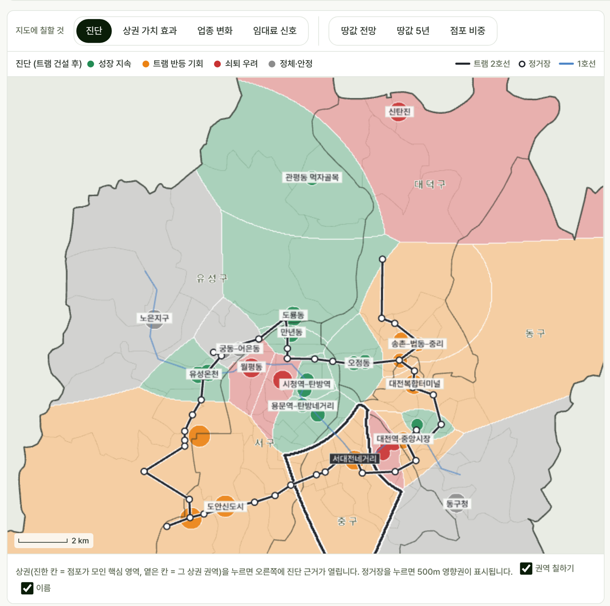
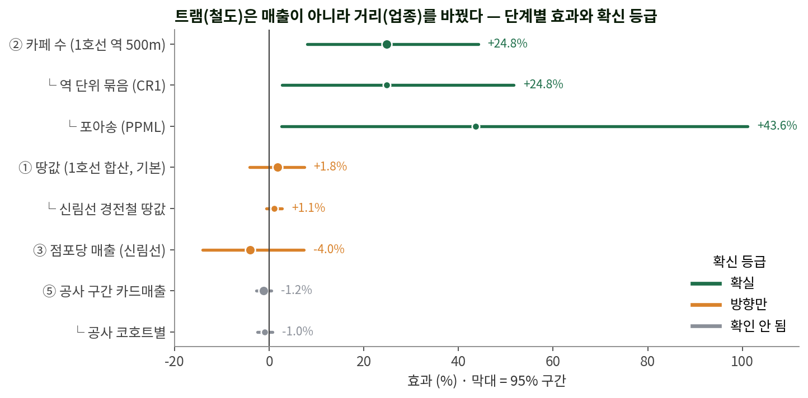
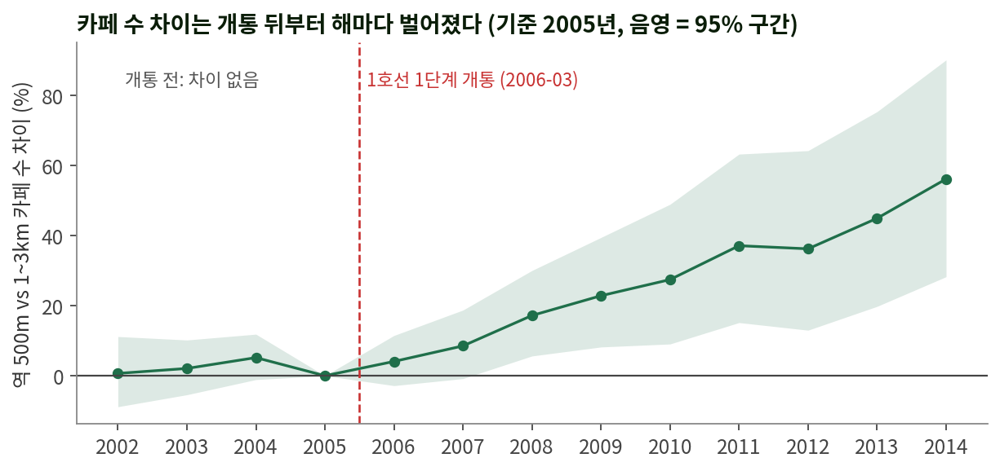
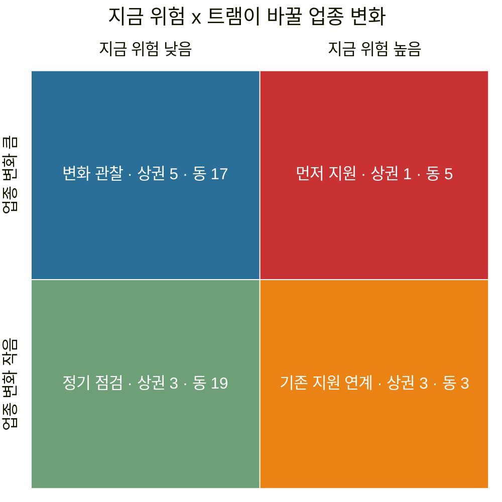
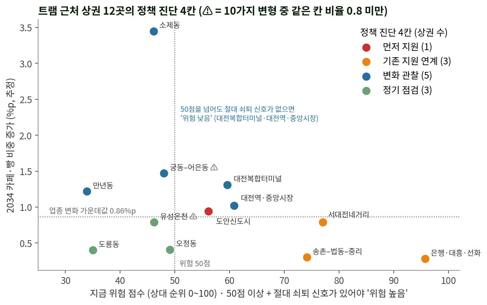
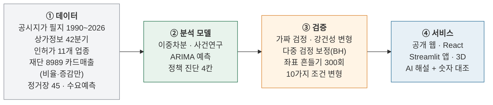
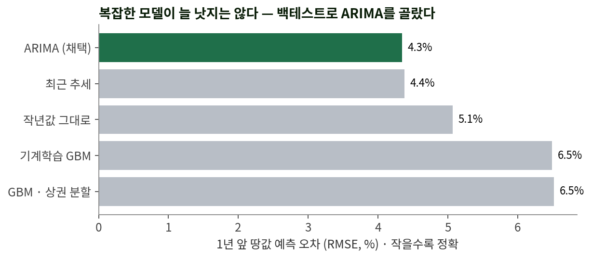
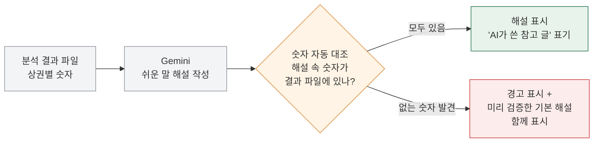
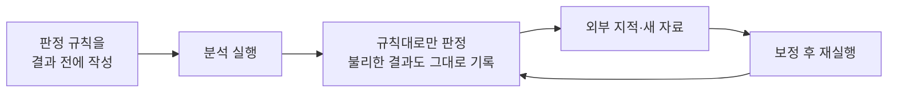
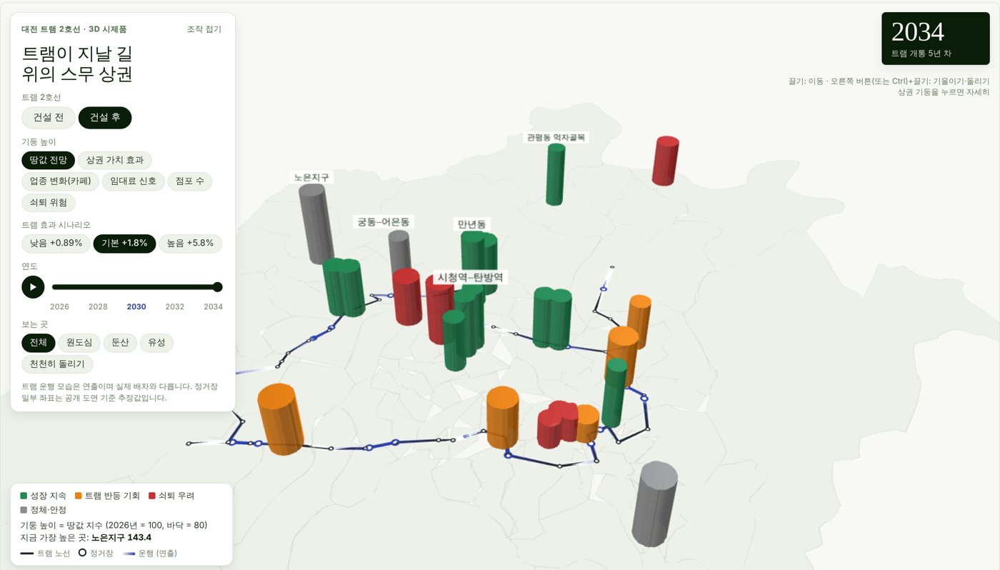

# 대전 트램 2호선 상권 변화 사전 진단 및 정책 의사결정 지원 시스템
**카페 쪽 업종 변화와 상권 위험을 진단하는 시·구 정책 지도**

> 핵심 메시지: **트램은 매출이 아니라 거리를 바꾼다** — 이미 개통한 대전 1호선(2006)의 전후 변화를 이중차분으로 재어, 2호선(2030 개통 예정) 정거장 주변을 미리 진단합니다.

[**▶ 공개 웹 지도 바로 열기**](https://daejeon-tram-map.netlify.app) · Python · Streamlit · pydeck · React · deck.gl · Gemini API · License: MIT



## 한눈에 보기

| | | | |
|:---:|:---:|:---:|:---:|
| **+24.8%**<br/>1호선 역 500m 카페 수<br/>(확실) | **+1.8%**<br/>정거장 500m 땅값<br/>(방향만) | **12곳 · 44곳**<br/>진단한 트램 근처<br/>상권 · 행정동 | **229개 → 30개**<br/>모든 검정 수 → 다중 검정<br/>보정 뒤 남은 수 |

- **누가 쓰나**: 시·자치구 소상공인·상권 정책 담당자. "공사 구간 상인을 어디부터 지원할지, 개통 뒤 어디를 지켜볼지"를 정하는 **정책 우선순위 도구**입니다. 개별 가게의 매출·투자 전망이 아닙니다.
- **무엇을 근거로**: 대전 1호선 역 주변과 먼 곳의 개통 전후 변화 차이(이중차분). 판정 기준은 결과를 보기 전에 적어 두었습니다.
- **무엇이 나왔나**: 확실히 달라진 것은 **업종(카페)** 하나입니다. 땅값은 오르는 방향이지만 크기가 불확실하고, 가게당 매출이 땅값만큼 오른 증거는 없습니다.

## 결과: 무엇이 확실하고 무엇이 아닌가



확신 등급: **확실** = p<0.01 + 두 가지 이상 검사 통과 + 다중 검정 보정 뒤 남음 · **방향만** = 방향은 여러 근거가 같지만 95% 구간이 0을 포함 · **확인 안 됨** = 유의하지 않거나 과거 자료와 맞지 않음

| 질문 | 결과 (요약) | 확신 등급 |
|---|---|:---:|
| ② 업종은 바뀌나 | 1호선 역 500m 카페 수 **+24.8% [8.0, 44.2]**. 가까운 역 단위로 묶어 다시 검정해도 유의(p 0.015), 개수용 회귀(포아송)로는 +43.6% → +24.8%는 보수적인 값. 2034년 대전 카페가 트램 없을 때보다 약 **276곳** 많음(89~376, 늘어나는 수가 아니라 덜 줄어드는 몫) | 🟢 확실 |
| ① 땅값은 오르나 | 정거장 500m 기본 **+1.8%**(낮음 0.9 ~ 높음 5.8%), 95% 구간이 0 포함. 서울 신림선(경전철) 같은 방법 +1.1%(유의하지 않음) | 🟠 방향만 |
| ③ 매출도 오르나 | 땅값 차이가 점포당 매출 차이보다 큼(차이 구간이 0보다 위). 신림선 점포당 매출 −4.0%(유의하지 않음), 주민 연령 통제에 민감 — **가게당 매출이 땅값만큼 오른 증거는 없음** | 🟠 방향만 |
| ④ 임대료 부담은 | 땅값-매출 간극 '높음' 6곳. 전국 53개 상권 검사에서 간극이 나중 임대료 상승을 예측하지 못함(ρ 0.19, p 0.16) → '오를 곳'이 아니라 **'지켜볼 곳'** | ⚪ 확인 안 됨 |
| ⑤ 공사 기간 영향 | 공사 구간 41개 동 카드매출 **−1.2% [−2.7, 0.4]**. 공사 시작 시점이 같은 동끼리만 묶어 공사 안 하는 동과 비교해도 −1.0%(p 0.26), 대전시가 정보공개로 알려 준 공사 영향 상권으로 바꿔도 −1.2%(유의하지 않음) | ⚪ 확인 안 됨 |

1호선 결과는 실제로 관측된 과거 변화이고, 2호선 수치는 그 결과를 빌린 추정(시나리오)입니다. 땅값과 매출의 비교는 이익·영업수익성 판단이 아닙니다. 공사 피해가 '확인 안 됨'인 것은 손실이 없다는 뜻이 아니라, 동 평균 자료로는 아직 증명되지 않았다는 뜻입니다.

### 왜 '카페'인가 — 유행이 아니라 개통 뒤에 벌어진 차이



같은 해끼리 역 주변과 먼 곳을 비교하므로 대전 전체의 카페 유행은 양쪽에 똑같이 들어가 빠집니다. 개통 전(2002~2004)에는 차이가 없다가 개통 뒤부터 벌어졌고, 개통 연도를 가짜로 바꾸면 효과가 사라집니다(+1.2%, p 0.75).

| 검사 | 카페 결과 |
|---|---|
| 개통 전 추세 (2002~04) | +2.6% — 차이 없음 (통과) |
| 가짜 개통 연도 · 무작위 처리군 | 효과 사라짐 · 재현 안 됨 (통과) |
| 역에서 거리별 | 0~300m +13% → 300~500m +9% → 500~750m +8% → 750~1,000m +4%(유의하지 않음) |
| 2단계 역(2008 개통)에서 따로 재현 | +27.5% |
| 가까운 역 18개 단위 묶음 (wild cluster bootstrap) | p 0.015 |

**카페만 골라서 본 것이 아닙니다.** 인허가 자료로 11개 업종을 같은 방법으로 검사했습니다.

| 구분 | 업종 |
|---|---|
| 🟢 모든 검사 통과 | 카페 |
| 🟡 개수는 늘었지만 비중은 그대로 | 빵·과자 |
| ⚪ 효과 없음 | 식사 음식점(개수 그대로, 음식점 중 비중 −5%p) · 간편식 · 편의점 · 주점 · 노래연습장 · 세탁 · 체력단련장 |
| ⚪ 참고 수준 | 미용(증가) · 숙박(감소) — 일부 변형에서만 유의 |
| ➖ 자료가 없어 검사 불가 | 안경·약국·의원(폐업 기록 2008년부터), 의류 등 일반 소매(인허가 대상 아님) → 개통 뒤 카드매출로 사후 검증 |

## 정책 진단 4칸 — 담당자가 할 일로 나눈 지도



| 칸 | 뜻 | 담당자가 할 일 | 상권 (트램 근처 12) | 행정동 (트램 근처 44) |
|---|---|---|:---:|:---:|
| 🔴 **먼저 지원** | 지금도 어렵고 트램으로 업종이 크게 바뀔 곳 | 공사 중·개통 초 지원 우선 | 1 | 5 |
| 🟠 **기존 지원 연계** | 어려움이 트램보다 원래 있던 쇠퇴 때문 | 기존 소상공인 정책과 연결 | 3 | 3 |
| 🔵 **변화 관찰** | 지금은 괜찮지만 업종이 크게 바뀔 곳 | 업종 변화 지켜보기 | 5 | 17 |
| 🟢 **정기 점검** | 변화가 적은 곳 | 분기 갱신 때 다시 보기 | 3 | 19 |
| ⬜ 비교 지역 | 노선 밖 | 분류하지 않음 | 8 | 38 |

- **가로축 (지금 위험)**: 위험 점수(점포 비중·폐업률·땅값 흐름의 대전 안 상대 순위) 50점 이상 **이면서** 절대 쇠퇴 신호(점포 비중 감소 + 폐업률이 대전 평균보다 높음)가 있을 때 '높음'
- **세로축 (업종 변화)**: 2034년 전체 점포 중 카페·빵집 비중이 늘어나는 정도(%p, 추정)가 트램 근처 가운데값 이상이면 '큼'
- **겹침 표시 (칸에 영향 없음)**: 공사 구간 테두리, 임대료 '지켜볼 곳' ⚑, 전통시장 테두리, 정거장 좌표에 민감한 곳 ⚑



진단은 대전 안 **상대 순위 + 절대 신호**로 만든 정책 우선순위입니다. 10가지 조건 변형(위험 지표 하나씩 빼기, 위험선 45/55, 업종 변화 낮음/높음 시나리오) 중 같은 칸이 나온 비율이 0.8 미만이면 '불확실'(⚠)로 표시합니다. 상권 단위 '먼저 지원'은 개발지인 도안신도시 1곳뿐이라, 실제 지원 대상 검토에는 행정동 단위(5곳)를 함께 보는 편이 정확합니다.

## 시스템 구조



`tram_model/run_all.py` 한 번으로 50여 단계 분석 전체를 다시 돌릴 수 있습니다(원본 자료 필요). 수치는 결과 파일에서 화면으로 자동 반영되므로, 다시 돌리면 웹·앱 숫자가 함께 바뀝니다.

## AI·분석 모델 — 문제마다 대안과 비교해 골랐습니다

| 풀려는 질문 | 모델 | 왜 이 모델인가 | 검증 | 결과 |
|---|---|---|---|---|
| 트램이 상권을 바꾸나? | **이중차분**(역 500m 격자 vs 1~3km, 연도·격자 고정효과) + 사건연구 | 단순 예측은 '트램 때문인지' 가리지 못함 → 개통이라는 사건 전후를 비교 | 개통 전 추세, 가짜 개통 연도, 무작위 처리군, 역 단위 묶음 검정, 포아송, 2단계 재현 | 카페 +24.8% 확실 |
| 땅값이 어떻게 갈까? | **ARIMA** + 트램 효과 시나리오(낮음·기본·높음) | 기계학습(GBM)·최근 추세·작년값과 1년 앞 오차로 비교 | 백테스트(과거 시점에서 실제로 예측해 보고 맞혀 봄) | 오차 최소 4.3% |
| 어디부터 지원하나? | **정책 진단 4칸**(위험 점수 + 절대 쇠퇴 신호 × 업종 변화) | 담당자가 할 일로 바로 이어지게. 이름에 '기회·쇠퇴'를 쓰지 않음 | 10가지 조건 변형 안정도, 정거장 좌표 300회 흔들기 | 상권 1·3·5·3 |
| 비슷한 상권끼리 묶으면? | **K-means**(k=4) | 정답 라벨이 없는 상권 유형 설명용(진단에는 쓰지 않음) | 부트스트랩 300회 평균 일치도(ARI) | ARI 약 0.48 |
| 상인에게 어떻게 설명하나? | **생성형 AI**(Gemini, 저장 해설은 Claude) | 결론은 통계가 만들고 AI는 쉬운 말로 바꾸기만 | 글 속 숫자를 결과 파일과 자동 대조 | 기본 해설 20곳 어긋난 숫자 0개 |



자료가 상권 20곳·1호선 역 22곳 규모라 딥러닝은 과적합 위험이 크고, 질문 자체가 '맞히기'보다 '원인 가리기'여서 인과 추정 방법을 중심에 두었습니다.

### 생성형 AI 해설은 숫자를 자동으로 대조합니다
결론은 통계 모델이 만들고, 생성형 AI는 그 결과를 상인·담당자가 읽기 쉬운 말로 바꾸기만 합니다. 프롬프트에는 결과 숫자만 넣고, AI가 쓴 글 속 숫자는 결과 파일과 기계로 대조합니다.



## 검증과 신뢰 — 결과 전에 규칙을 정하고, 지적을 받으면 다시 검증



| 실제로 다시 검증한 일 | 무엇을 바꿨나 | 결과 |
|---|---|---|
| 재단이 노선도와 정거장 위치가 다르다고 지적 | 공식 정거장 위치도와 대조해 15곳 보정 → 전체 재실행 | 1호선 효과 그대로 |
| 대전시 정보공개(공사 영향 상권) | 공사 분석 처리군을 시 목록으로 교체 | −1.2%, '확인 안 됨' 유지 |
| 모델 점검: 같은 역 주변 격자는 함께 움직임 | 역 단위 묶음 검정·포아송·공사 시작 시점별 비교 추가 | 등급·숫자 그대로 |
| 검정을 많이 하면 우연히 유의할 수 있음 | 모든 검정 229개를 한 목록에 모아 BH 보정 | 30개 남음, 카페 기본 효과 포함 |

판정 규칙 원문: `tram_model/docs/사전분석계획_2차점검_1103.md`(전체), `사전분석계획_분류변경_1112.md`(진단 4칸), `사전분석계획_공사_시목록_1112.md`(공사), `사전분석계획_검정보강_1113.md`(역 단위·포아송·공사 시점). 검정 목록: `tram_model/outputs/tests_registry.csv`.

## 빠른 실행
```bash
pip install -r tram_model/requirements.txt
streamlit run app.py          # 저장소에 든 분석 결과로 지도 앱 실행 (http://localhost:8501)
```
- 설치 없이 보려면 [공개 웹 지도](https://daejeon-tram-map.netlify.app)를 여세요.
- AI 실시간 해설은 `.streamlit/secrets.toml`에 `GEMINI_API_KEY`를 넣으면 켜집니다. 없으면 저장 해설만 보입니다. API 키는 저장소에 포함하지 않습니다.
- 8989 상권분석 자료는 재배포 금지 조건 때문에 빠져 있어, 해당 수치가 필요한 일부 항목은 앱에서 표시되지 않을 수 있습니다.
- 이 README의 그래프는 `python tram_model/make_readme_figs.py`로 결과 파일에서 다시 그립니다.



## 저장소 구성
| 경로 | 내용 |
|---|---|
| `app.py` | Streamlit 지도 앱 (진단 지도, 상권 상세, AI 해설, 3D 보기) |
| `app_3d.py` | 3D 시제품 |
| `tram_model/` | 분석 코드 전체. 전체 재실행 `python tram_model/run_all.py`, 진행 기록 `PROGRESS.md` |
| `tram_model/docs/` | 결과 전에 쓴 판정 규칙, 사후 검증 설계 |
| `tram_model/outputs/` | 공개용 분석 결과 (8989 행정동 값은 제외) |
| `web/` | 공개 웹사이트 (React 정적 사이트). 자세한 내용은 `web/README.md` |
| `web_data/` | 웹사이트용 자료 (`python tram_model/export_web.py` 로 생성) |
| `docs/img/` | README 그림 |

### 공개 웹사이트 배포
1. `python tram_model/export_web.py` → `web_data/` 갱신
2. `cd web && node build.mjs --prod` → `web/dist/`
3. `web/dist/` 폴더를 Netlify Drop(app.netlify.com/drop)에 끌어다 놓기

## 한계
| 한계 | 대응 |
|---|---|
| 대전 트램은 2030년 개통이라 효과를 직접 잴 수 없음 | '예측'이 아니라 비슷한 과거 사례로 만든 사전 진단으로 표현 |
| 1호선(지하철) 결과를 지상 트램에 빌려 씀, 국내 지상 트램 근거 없음 | 서울 신림선(경전철)·해외 지상 트램 문헌으로 방향 확인, 위례선 개통 뒤 같은 규칙으로 사후 검증하는 설계 준비 |
| 카페 '확실'은 1단계 처리 역 12개에 기댐 | 역 단위로 묶으면 p 0.015로 약해지고, 이 검정은 다중 검정 보정 뒤에는 남지 않음 → 2단계 역 재현을 함께 근거로 듦 |
| 공사 피해는 펜스 앞 가게 단위 자료가 없음 | 동 평균으로만 측정, 공구별 공식 공사 일정은 대전시에 청구 중(답변 대기) |
| 정거장 45곳 중 17곳은 정류장 위치로 추정 | 13곳 설계 도면, 15곳 공식 위치도 대조(오차 약 ±200m). 좌표를 300번 흔들어 진단이 흔들리는 곳(상권 4곳·동 17곳)을 지도에 ⚑ 표시. 공식 위치도 그림은 싣지 않음 |
| 전통시장 현금 매출은 카드매출에 잡히지 않음 | 지도에 전통시장 테두리로 표시 |

## 자료 이용 안내 (꼭 읽어 주세요)
- 이 저장소에는 **분석 코드·문서·공개용 결과 요약만** 들어 있습니다. 원본 데이터(`tram_model/data/raw/`)는 포함하지 않습니다.
- **자료 출처: 대전광역시·대전신용보증재단, 「대전 소상공인 상권분석 서비스」(https://8989.daejeon.go.kr)** — 활용 허가(2026-10, 보안 유지·재배포 금지·출처 명시 조건)를 받아 분석에 썼습니다.
  ※ 상권분석 서비스의 일부 통계를 활용하여 충남대학교 학생 연구팀이 자체 분석·가공한 결과이며, 대전광역시 또는 대전신용보증재단의 공식 분석이나 전망은 아님.
  행정동별 세부 매출 수치는 저장소·웹·앱 화면 어디에도 표시하지 않습니다. 그 조건에 따라 **원자료와 재집계 표(동·월·업종별 매출, 유동인구, 소득, 폐업 등)는 이 저장소에 넣지 않았고**, 효과 추정치 요약만 남겼습니다. 같은 자료를 쓰려면 재단에 직접 허가를 받아야 합니다.
- 공공데이터(출처 표시 조건, 공공누리): 국토교통부 개별공시지가·전국 버스정류장, 소상공인시장진흥공단 상가(상권)정보, 행정안전부 지방행정인허가(LOCALDATA), 통계청 행정동 경계, 한국부동산원 상업용부동산 임대동향·R-ONE, 서울 열린데이터광장 상권분석서비스·개별공시지가, 국가공간정보포털 연속지적도(서울, 신림선 비교용), 대전광역시 자치구별 신용카드(KB국민카드) 매출액(공공데이터포털 15064213), 대전광역시 2021 소상공인 실태조사, 한국철도공사 역별 승하차, 문화체육관광부 주요관광지점 입장객 통계, 대전광역시 트램 2호선 정거장 자료(설계도면, 대전트램 누리집 정거장 위치도·노선도 — 좌표 대조에만 쓰고 그림은 싣지 않음), 대전광역시 「도시철도 2호선 기본계획(변경)」 정거장별 수요예측과 공사 구간 상권·지원 현황(2026-11 정보공개 청구 답변).
- 관광지 좌표 일부는 OpenStreetMap 기여자 자료(ODbL)로 산출했습니다. 카카오 로컬 API 결과는 저장·재제공 금지 조건에 따라 사용하지 않습니다.
- 공개 웹의 바탕 지도(CARTO 타일, © OpenStreetMap contributors)는 기본적으로 꺼져 있으며, 켜려면 CARTO API 키와 출처 표시가 필요합니다.
- AI 해설은 Google Gemini API(저장 해설 20곳은 Claude)가 쓴 참고 글이며, 수치는 모두 이 분석 결과에서 가져옵니다.
- README 그래프의 글꼴은 Noto Sans CJK(SIL Open Font License)로 그렸습니다.
- 모든 결과는 공개 자료로 만든 **추정값이자 '비슷한 과거 사례로 만든 사전 진단'**입니다. 투자·임대·계약 판단의 근거로 쓰지 마세요.
- 코드·문서 라이선스: MIT (`LICENSE`). 오픈소스 고지: `web/public/THIRD_PARTY_NOTICES.txt`.
